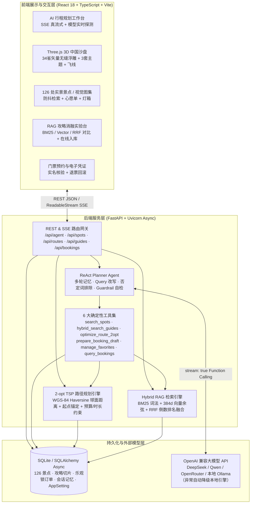
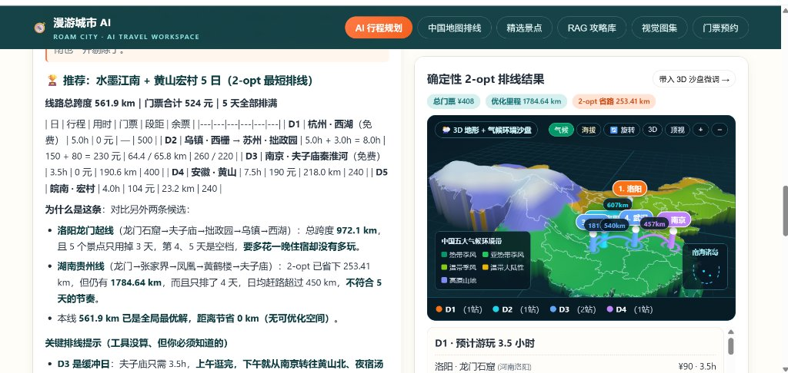
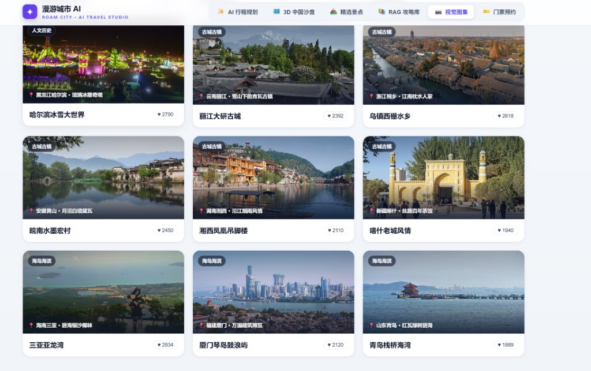

# 漫游城市 AI · RoamCity AI

> **AI 驱动的全栈旅行规划与 3D 地理沙盘系统**：基于 **React 18 + TypeScript + Three.js** 与 **FastAPI + SQLAlchemy Async** 构建，融合 **ReAct 多工具流式 Agent**、**Hybrid RAG（BM25 + 384d 向量 RRF）**、**2-opt TSP 确定性路径规划** 以及 **乐观锁并发门票事务**，覆盖全国 34 省市 **126 处实景地标**。

## 系统架构



## 核心功能与页面展示

### 1. AI 模型配置、可用性实测与多轮对话工作台
支持任意 OpenAI 兼容端点（DeepSeek / 通义千问 / SiliconFlow / OpenRouter / Ollama），内置 `/models` 自动发现、并发可用性延迟探测与持久化配置。


### 2. ReAct 6 工具流式编排 + 确定性 2-opt 排线联动
实时展示 Tool Call / Tool Output 调用链路、零幻觉 Markdown 表格行程单、攻略引用 `[1]` 溯源，并与右侧 3D 沙盘实时联动预览景点实景。


### 3. Three.js 34 省无缝浮雕 3D 中国沙盘 + 2-opt TSP 实验室
基于 `d3-geo` Mercator 投影与 `Three.js` 构建 34 省自适应三角网细分浮雕地形与解析法线，支持 **海拔阶梯 / 五大气候带 / 星夜全息** 三大主题零延迟切换、省份悬浮高亮抬升、碰撞避让地名标注、126 处真实经纬度水晶光柱与 3D 贝塞尔飞线。


### 4. 全国 126 处精选实景地标与心愿单检索
覆盖全国 34 个省级行政区的 126 处真实高清实景摄影地标，支持分类筛选、免费景区过滤、防抖搜索、多维度排序及心愿单云端同步。


### 5. Hybrid RAG 攻略检索、消融对比与动态入库
支持实时切换 `Hybrid RRF` / `仅 BM25` / `仅 384d 向量` 三种检索模式并高亮命中词，支持在线导入自定义攻略自动切片向量化入库。


### 6. 山河实景视觉图集
精选高清实景大片卡片流，支持按风光主题筛选、点赞互动与键盘方向键（`←` / `→` / `Esc`）全屏灯箱浏览。


### 7. 数据库事务门票预约（乐观锁防超卖 + 电子核销凭证）
基于版本号 `version` 实现高并发乐观锁库存扣减（单测验证 8 并发不超卖），支持 18 位实名核验脱敏、两步确认退票回滚库存及电子入园二维码凭证。


## 关键技术指标与离线评测

- **AI Agent 评测**（`backend/eval/eval_agent.py`，6 组多轮约束评测集）：零幻觉落地率 **100.0%（6/6）**、总体约束遵循率 **100.0%（6/6）**。
- **Hybrid RAG 消融评测**（`backend/eval/eval_rag.py`，20 条 QA 评测集）：

| 检索模式 | Recall@1 | Recall@3 | Recall@5 | MRR@5 |
| --- | ---: | ---: | ---: | ---: |
| `bm25` | 100.0% | 100.0% | 100.0% | 1.0000 |
| `vector` | 80.0% | 95.0% | 100.0% | 0.8683 |
| `hybrid` (RRF) | 95.0% | 100.0% | 100.0% | 0.9750 |

- **并发安全测试**（`backend/tests/test_api.py`）：7 项核心单测与集成测试全部通过，包含 8 并发抢票乐观锁防超卖验证。

## 快速开始

### 1. 启动后端（FastAPI）

```bash
cd backend
python -m venv .venv
# Windows: .\.venv\Scripts\pip install -r requirements.txt
# Linux/macOS: ./.venv/bin/pip install -r requirements.txt
./.venv/bin/python -m uvicorn app.main:app --reload --port 8000
```

如需默认接入外部大模型，可复制 `backend/.env.example` 为 `backend/.env` 并填写 `LLM_API_KEY`、`LLM_BASE_URL`、`LLM_MODEL`，或在前端「模型配置与可用性检测」面板中直接配置并保存。

### 2. 启动前端（React + TypeScript + Vite）

```bash
cd frontend
npm install
npm run dev
```

浏览器访问 `http://localhost:5173`（Vite 已配置 `/api` 代理转发至 `http://127.0.0.1:8000`）。

### 3. 测试与评测

```bash
# 后端单元测试与并发防超卖测试
cd backend && ./.venv/bin/python -m pytest -v

# RAG 离线消融评测
cd backend && PYTHONPATH=. ./.venv/bin/python -m eval.eval_rag

# AI Agent 多轮约束与零幻觉评测
cd backend && PYTHONPATH=. ./.venv/bin/python -m eval.eval_agent

# 前端 TypeScript 类型检查与生产构建
cd frontend && npm run build
```

## 目录结构

```text
roam-city/
├─ .github/workflows/       # GitHub Actions CI（pytest + RAG/Agent 评测 + Vite 构建）
├─ backend/                 # FastAPI + SQLAlchemy Async 后端
│  ├─ app/
│  │  ├─ agent/             # 多轮记忆 + Query 改写 + 6 工具流式 ReAct Agent
│  │  ├─ algo/              # Haversine + 2-opt TSP 确定性路径规划
│  │  ├─ api/               # REST & SSE 路由（模型探测 / RAG 入库 / 乐观锁预约 / 心愿单）
│  │  ├─ core/              # Pydantic Settings 配置
│  │  ├─ db/                # SQLAlchemy Async 模型与 126 景点 / 17 攻略切片种子数据
│  │  └─ rag/               # BM25 + 384d 向量 RRF 混合检索引擎
│  ├─ eval/                 # RAG 消融与 AI Agent 多轮约束评测集
│  └─ tests/                # Pytest 算法、并发防超卖与多轮 Agent 测试
├─ frontend/                # React 18 + TypeScript + Vite 前端
│  ├─ public/scenes/        # 126 处全国实景地标高清摄影资源
│  └─ src/
│     ├─ api/               # REST 客户端与 ReadableStream SSE 流式解析
│     ├─ components/        # AI 工作台 / 3D 中国沙盘 / 精选景点 / RAG 实验台 / 图集 / 门票预约
│     └─ utils/             # 34 省无缝浮雕地形网格与解析梯度法线着色引擎
└─ images/                  # README 页面展示截图
```

## 安全与开源协议

- **安全防护**：内置 HTTP 安全响应头（`X-Frame-Options` / `X-Content-Type-Options` / `Referrer-Policy`）、外部 LLM 端点 **SSRF 拦截校验**、关键写接口 **IP 滑动窗口限流**、乐观锁并发防超卖与敏感字段脱敏，详见 [SECURITY.md](SECURITY.md)。
- **开源协议**：本项目基于 [MIT License](LICENSE) 开源，仅限技术学习与合法合规演示使用，禁止用于未授权探测或恶意滥用。
