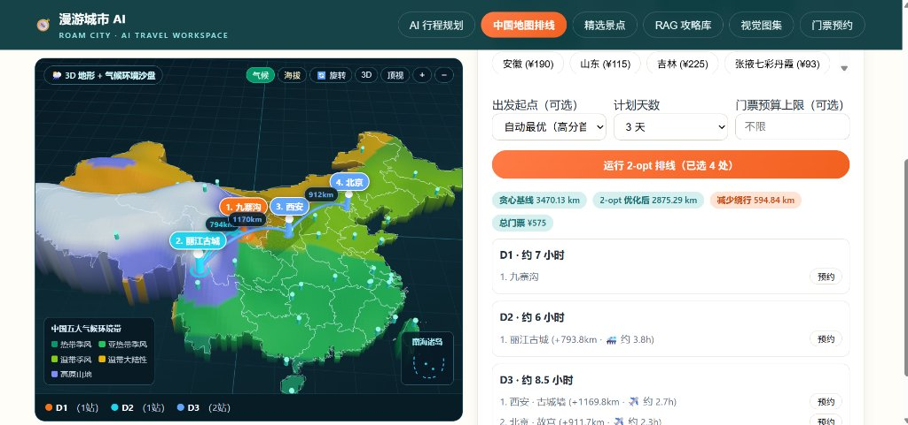
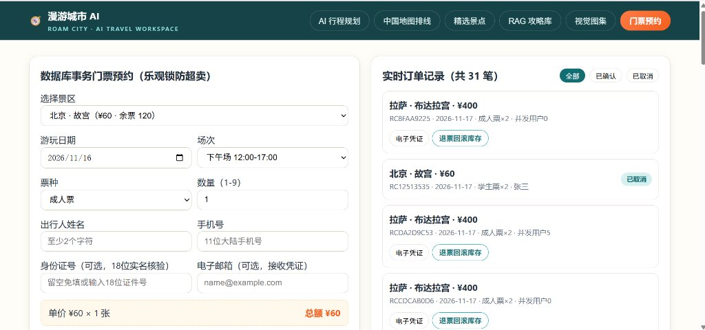

# 漫游城市 AI · RoamCity AI

> 从大一纯静态前端课设重构升级为 **AI 应用全栈工程项目**：**React 18 + TypeScript + Vite**（前端）+ **Python FastAPI + SQLAlchemy Async**（后端）+ **Hybrid RAG（BM25 + 向量 RRF）** + **2-opt TSP 路径规划算法**。

## 页面效果展示

### 1. AI 行程规划工作台（多轮对话 + ReAct 工具编排 + 3D 沙盘联动）


### 2. 3D 中国三级阶梯海拔 / 气候沙盘与 2-opt 排线实验室


### 3. 精选景点检索、排序与心愿单


### 4. Hybrid RAG 攻略检索、关键词高亮与原文溯源


### 5. 数据库事务门票预约（乐观锁防超卖 + 电子入园凭证）


## 核心架构与技术亮点

1. **AI 行程规划 Agent（多轮记忆 + 6 工具真流式调用 + 实时模型检测与持久化）**
   - `backend/app/agent/planner_agent.py`：支持多轮会话持久化（`ChatTurn`，刷新与切页自动恢复对话及 3D 路线）、多轮指代 Query 改写、否定词地区排除（如“不去西北”）、出发地锚定、游览节奏控制与预算/余票 Guardrail 自检。
   - **模型接入、持久化与可用性探测**：支持 `.env` 或前端「⚙️ 模型配置与可用性检测」面板配置 OpenAI 兼容端点，支持 **「💾 保存配置」**（`AppSetting` 落库 + `localStorage`）、**`POST /api/agent/detect-models`**（实时拉取 `/models` 并并发实测可用模型延迟与状态）与 **`POST /api/agent/test-llm`**；Agent 启用 `stream: true` 真·首字流式 **6 工具调用**（`search_spots`、`hybrid_search_guides`、`optimize_route_2opt`、`prepare_booking_draft`、`manage_favorites`、`query_bookings`），异常时显式上报降级原因并切换本地兜底引擎。
   - **流式 Markdown 与跨模块联动**：`frontend/src/components/MarkdownView.tsx` 零依赖防 XSS 实时排版，点击 `[1]` 引用可直达「RAG 攻略库」，并支持「带入 3D 沙盘微调」及导出 `.md` 行程单。
   - `backend/eval/eval_agent.py`（6 组多轮与约束评测集）：**零幻觉落地率 100.0%（6/6）**、**总体约束遵循率 100.0%（6/6）**。
2. **3D 中国三级阶梯海拔/气候沙盘 + 确定性路径规划（Anti-Hallucination）**
   - `frontend/src/components/ChinaRouteMap.tsx` & `utils/chinaTerrain.ts`：基于 `d3-geo` Mercator 投影与 **Three.js WebGL** 渲染 `122×90` 网格立体浮雕地形，支持 **⛰️ 三级阶梯海拔高度** 与 **🌦️ 五大气候环境带** GPU 瞬时切换、**36 个真实经纬度景区光柱** 及 **3D 二次贝塞尔航线飞线**，工作台双栏支持下滑时 3D 地图吸顶悬停。
   - `backend/app/algo/route_planner.py`：基于 WGS-84 经纬度计算 **Haversine 球面距离**，使用 **最近邻贪心 + 2-opt 局部搜索** 在预算、指定出发起点（`start_spot_id`）与每日时长约束下求解最优顺序，量化对比节省里程并估算跨城交通耗时。
3. **Hybrid RAG 攻略检索、消融对比、动态入库与量化评测**
   - `backend/app/rag/retriever.py` & `POST /api/guides/ingest`：内置 **8 篇攻略 / 17 个章节切片**（支持页面导入自定义攻略文本自动切片并生成 384 维向量入库），支持前端实时切换 **`hybrid`（BM25 + Vector RRF）/ `bm25` / `vector`** 三种检索模式并高亮命中关键词。
   - `backend/eval/eval_rag.py` 在 20 条评测集（`eval/qa_dataset.json`）上的实测消融结果：

| 检索模式 | Recall@1 | Recall@3 | Recall@5 | MRR@5 |
| --- | ---: | ---: | ---: | ---: |
| `bm25` | 100.0% | 100.0% | 100.0% | 1.0000 |
| `vector` | 80.0% | 95.0% | 100.0% | 0.8683 |
| `hybrid` (RRF) | 95.0% | 100.0% | 100.0% | 0.9750 |

4. **并发安全的乐观锁门票预约、景点筛选与图集**
   - `backend/app/api/routes.py` & `BookingDesk.tsx`：通过版本号 `version` 实现分景点余票乐观锁扣减（单测覆盖 **8 并发请求不超卖**），支持 18 位身份证/邮箱实名字段与脱敏展示、订单状态筛选、两步确认退票回滚库存及**电子入园核销凭证**。
   - 支持 `/api/favorites` 心愿单持久化与一键导入 3D 排线、景点按评分/票价/免费/热度筛选并定位 3D 沙盘，以及带键盘灯箱切换的「视觉图集」。

## 本地运行（前后端分离）

### 1. 启动后端（FastAPI）

```powershell
cd backend
.\.venv\Scripts\python.exe -m uvicorn app.main:app --reload --port 8000
```

如需接入真实大模型，复制 `backend/.env.example` 为 `backend/.env` 并填写 `LLM_API_KEY`、`LLM_BASE_URL`、`LLM_MODEL`。

### 2. 启动前端（React + TypeScript + Vite）

```powershell
cd frontend
npm run dev
```

浏览器访问 `http://localhost:5173`（Vite 已配置 `/api` 反向代理至 `http://127.0.0.1:8000`）。

### 3. 运行测试与构建验证

```powershell
# 后端单元测试与并发/多轮集成测试
cd backend
.\.venv\Scripts\python.exe -m pytest -v

# RAG 离线量化评测（BM25 vs Vector vs Hybrid RRF）
cd backend
$env:PYTHONPATH="."; .\.venv\Scripts\python.exe -m eval.eval_rag

# AI Agent 多轮约束与零幻觉离线评测
cd backend
$env:PYTHONPATH="."; .\.venv\Scripts\python.exe -m eval.eval_agent

# 前端类型检查与生产构建
cd frontend
npm run build
```

## 目录结构

```text
.
├─ .github/workflows/       # GitHub Actions CI（pytest + RAG eval + Agent eval + Vite build）
├─ backend/                 # Python 3.13 + FastAPI 后端
│  ├─ app/
│  │  ├─ agent/             # 多轮记忆 + Query 改写 + 6 工具流式 Agent 编排
│  │  ├─ algo/              # Haversine + 2-opt（含出发起点锚定）路径规划算法
│  │  ├─ api/               # REST & SSE 路由（LLM 检测保存 / RAG 入库 / 并发预约 / 心愿单）
│  │  ├─ core/              # Pydantic Settings 配置
│  │  ├─ db/                # SQLAlchemy Async 模型（含 AppSetting）与 36 景点/17 攻略切片种子数据
│  │  └─ rag/               # BM25 + Vector RRF 混合检索
│  ├─ eval/                 # RAG 与 AI Agent 离线量化评测集与消融脚本
│  └─ tests/                # Pytest 算法、并发防超卖、RAG 入库与多轮 Agent 测试（7 项）
├─ frontend/                # React 18 + TypeScript + Vite 前端
│  ├─ public/scenes/        # 景区矢量插画资源
│  └─ src/
│     ├─ api/               # REST 客户端与 ReadableStream SSE 解析
│     ├─ components/        # AI 工作台 / 3D 沙盘排线 / 景点检索 / RAG 消融入库 / 图集 / 门票凭证
│     └─ utils/             # 中国三级阶梯海拔地形与五大气候带着色模型
├─ images/                  # 项目页面效果截图（嵌入 README）
└─ index.html ...           # 大一初版静态页面（已修复已知弹窗与 XSS 隐患）
```
