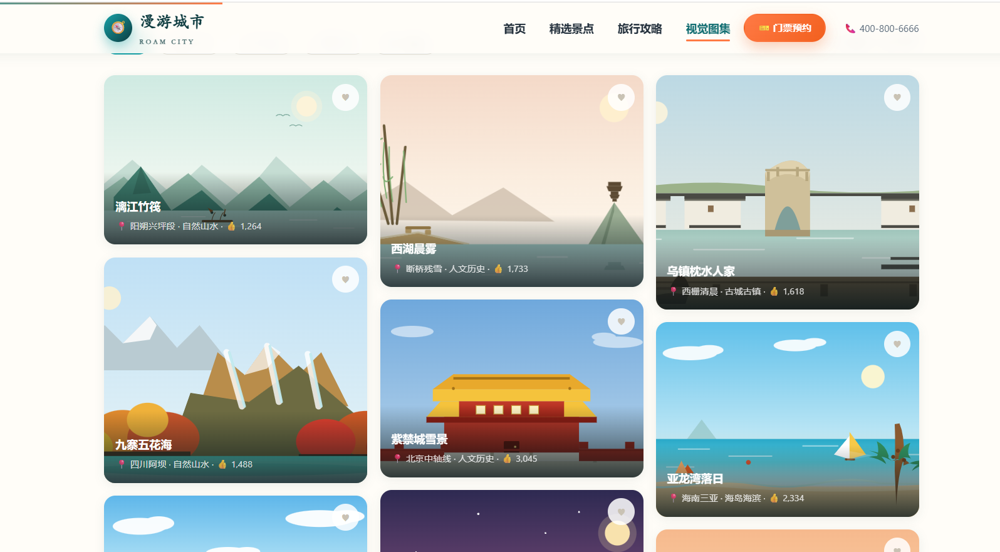

# 漫游城市 · 旅游攻略站

纯 HTML / CSS / JavaScript 实现的多页面旅游攻略站点。无框架、无构建步骤、无后端依赖；数据内置于 JS，插画为本地 SVG，支持 `file://` 协议下直接运行。

## 预览

首页截图（`images/home.png`）：



## 页面

| 页面 | 说明 |
| --- | --- |
| `index.html` | 首页：视差首屏、热门目的地、编辑精选轮播、经典路线、旅友评价 |
| `scenic.html` | 精选景点：分类 / 关键词筛选、收藏、详情弹窗 |
| `guide.html` | 旅行攻略：文章切换、目录滚动高亮、FAQ 折叠 |
| `gallery.html` | 视觉图集：瀑布流、Lightbox 灯箱 |
| `booking.html` | 门票预约：表单校验、订单本地保存与取消 |

## 功能

- 响应式布局（断点 992 / 768 / 480 px），移动端汉堡菜单
- CSS 动效：首屏视差、打字机文案、滚动进场、数字滚动
- 组件：轮播、Tab、手风琴、Modal、Lightbox、瀑布流、Toast
- 表单校验：姓名 / 手机号 / 身份证 / 邮箱正则，日期与条款校验
- `localStorage` 持久化：收藏、预约订单、订阅邮箱
- 页面间 URL 参数联动（`?spot=` / `?cat=` / `?keyword=` / `?g=`）

## 运行

```
# 本地直接运行（无需服务器，离线可用）
双击 index.html，使用 Chrome / Edge 打开

# 预览响应式效果
F12 → 设备模拟（手机 / 平板尺寸）
```

可选：部署到 GitHub Pages。Settings → Pages → Source 选择 `main` 分支，构建完成后即可通过 `https://<用户名>.github.io/roam-city-web/` 访问。

## 目录结构

```
.
├─ index.html
├─ scenic.html
├─ guide.html
├─ gallery.html
├─ booking.html
├─ assets/
│  ├─ css/
│  │  └─ style.css         全站样式
│  ├─ js/
│  │  ├─ main.js           公共脚本（导航 / 预加载 / 收藏 / Toast 等）
│  │  ├─ data.js           站点数据
│  │  ├─ home.js           首页
│  │  ├─ scenic.js         景点页
│  │  ├─ guide.js          攻略页
│  │  ├─ gallery.js        图集页
│  │  └─ booking.js        预约页
│  └─ images/
│     └─ scenes/           本地 SVG 插画（11 幅）
└─ README.md
```

## 技术要点

- 语义化 HTML5，含基础 ARIA 标注
- CSS 变量统一设计令牌；Flex / Grid / Columns 三类布局
- IntersectionObserver 实现滚动进场动画与数字滚动
- 动态内容由页面脚本同步渲染，滚动观察器可见
- `URLSearchParams` + `history.replaceState` 同步筛选状态（`file://` 下自动降级）

无第三方依赖，全部为原生 Web 技术。用于 Web 前端课程作业演示。
